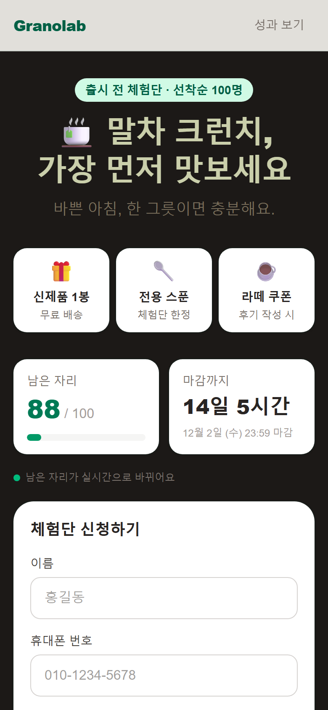
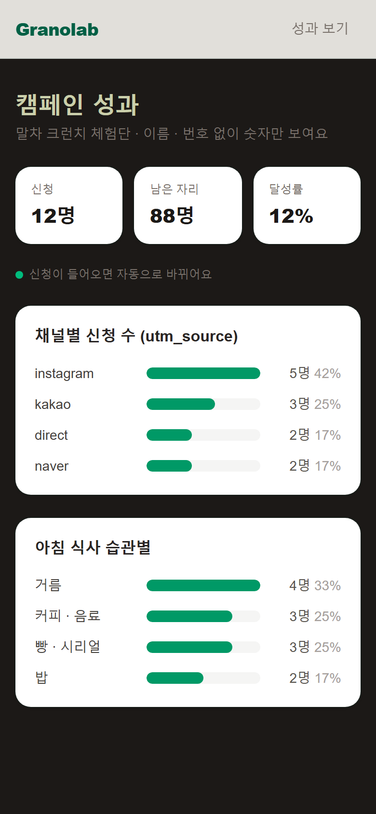

# granolab — 말차 크런치 체험단 선착순 사전 신청

> 가상 브랜드 **그래놀랩**이 신제품 "말차 크런치" 체험단 100명을 선착순으로 모으고, 어느 채널에서 신청이 들어왔는지 숫자로 볼 수 있게 만든 캠페인 웹페이지예요.

<p>
  
  
</p>

- 🔗 배포 링크: https://granolab-mu.vercel.app
- 현재 버전: v1 (2026-11-18) · 지난 버전 기록은 [CHANGELOG.md](CHANGELOG.md)
- ⚠️ 수업 과제용 **가상 이벤트**예요. 실제 이름 · 번호 대신 가짜 정보를 넣어 주세요.

## 왜 만들었나요?

출시 전 체험 후기를 모으면서, **어느 채널(인스타그램 · 카카오 등)에서 어떤 고객이 왔는지**를 마케터가 숫자로 바로 확인하고 싶었어요. 그러면서도 신청자 개인정보는 화면에 절대 드러나지 않게 하는 것이 목표예요.

## 주요 기능

- **랜딩 + 신청 폼** (`/`): 남은 자리 "N / 100"과 마감까지 남은 시간을 보여 주고, 이름 · 휴대폰 번호 · 아침 식사 습관 · 개인정보 동의를 받아요.
- **실시간 남은 자리**: 누군가 신청하면 다른 사람 화면의 숫자도 새로고침 없이 줄어들어요.
- **선착순 · 마감 · 중복 막기**: 100명이 차거나 마감일(2026-12-02 23:59, 한국 시간)이 지나면 신청을 받지 않아요. 같은 번호는 한 번만 신청할 수 있어요. 이 규칙은 DB가 직접 막아요.
- **유입 경로 저장**: 주소의 `utm_source` · `utm_medium` · `utm_campaign`을 신청과 함께 저장해요. 없으면 `direct`로 저장해요.
- **성과 페이지** (`/stats`): 총 신청 수 · 남은 자리 · 채널별 · 아침 습관별 신청 수를 숫자와 막대로 보여 줘요. **이름 · 번호는 어디에도 나오지 않아요.**
- **앱처럼 설치 (PWA)**: 휴대폰 홈 화면에 추가하면 주소창 없이 열려요. 인터넷이 끊기면 마지막으로 본 화면과 "인터넷이 끊겼어요" 안내를 보여 주고, 신청 버튼은 연결될 때까지 잠가요.

## 기술 스택

| 구분 | 사용한 것 |
| --- | --- |
| 프레임워크 | Next.js 16.4.6 (App Router) · React 19.3.0 · TypeScript 5 |
| 스타일 | Tailwind CSS 4.3.3 |
| DB · 실시간 | Supabase (`@supabase/supabase-js` 2.x) |
| 앱 설치 · 오프라인 | Web App Manifest (`app/manifest.ts`) · 서비스 워커 (`public/sw.js`) |
| 배포 | Vercel |

## 시작하기

### 요구사항

- Node.js (v24에서 확인했어요)
- Supabase 프로젝트 1개

### 설치 및 실행

```bash
git clone https://github.com/acywh-maker/granolab.git
cd granolab
npm install
```

1. Supabase 대시보드의 **SQL Editor**에서 [`DB.md`](DB.md)의 **7. SQL** 부분을 실행해 표와 함수를 만들어요.
2. 아래 [환경 변수](#환경-변수--설정)를 `.env.local`에 채워요.
3. 개발 서버를 켜요.

```bash
npm run dev
```

브라우저에서 http://localhost:3000 을 열면 돼요.

## 환경 변수 / 설정

`.env.example`을 복사해 `.env.local`을 만들고 값을 채워요.

```bash
cp .env.example .env.local
```

| 이름 | 설명 | 어디서 찾나요 |
| --- | --- | --- |
| `NEXT_PUBLIC_SUPABASE_URL` | Supabase 프로젝트 주소 | Supabase → Project Settings → API |
| `NEXT_PUBLIC_SUPABASE_PUBLISHABLE_KEY` | 공개용(publishable) 키 | 같은 화면의 Publishable key |

> secret key는 쓰지 않아요. 신청자 표는 잠겨 있고, 앱은 정해진 함수(`granolab_apply`, `granolab_stats`)로만 DB에 접근해요.

정원(100명)과 마감 시각은 코드가 아니라 DB의 `granolab_settings` 표에서 바꿔요.

## 사용법

**채널별 링크로 신청 받기**

채널마다 utm을 붙인 링크를 따로 뿌려요.

```
https://granolab-mu.vercel.app/?utm_source=instagram&utm_medium=story&utm_campaign=matcha
```

이 링크로 들어와 신청하면 `instagram`으로 집계돼요.

**성과 보기**

`/stats`를 열어 두면 신청이 들어올 때마다 채널별 · 아침 습관별 숫자가 바로 바뀌어요.

**휴대폰 홈 화면에 추가하기**

신청 완료(`/done`)나 성과(`/stats`) 화면 아래쪽에 설치 안내가 떠요. 신청 버튼을 가리지 않도록 신청 화면(`/`)에서는 띄우지 않아요.

| 휴대폰 · 브라우저 | 방법 |
| --- | --- |
| 안드로이드 (크롬 등) | [설치하기] 버튼 |
| 아이폰 (사파리) | 공유 버튼 → "홈 화면에 추가" |
| 카카오톡 · 인스타그램 안에서 연 경우 | 홈 화면 추가가 안 돼요 → 다른 브라우저로 열어 주세요 |

## 프로젝트 구조

```
app/
  page.tsx          랜딩 + 신청 폼 (/)
  actions.ts        신청 저장 (Server Action)
  done/page.tsx     신청 완료 (/done) — "N번째 신청자예요"
  stats/page.tsx    성과 페이지 (/stats)
  manifest.ts       앱 이름 · 아이콘 · 색 (홈 화면 설치용)
components/
  SignupSection.tsx 남은 자리 · 마감 카운트다운 · 신청 폼
  StatsView.tsx     성과 숫자와 막대 (실시간)
  useLiveStats.ts   실시간 숫자 받기
  InstallPrompt.tsx 홈 화면 추가 안내
  PwaSetup.tsx      서비스 워커 등록 · 오프라인 안내 띠
lib/                Supabase 연결 · 캠페인 규칙 · 집계 · DB 타입
public/sw.js        서비스 워커 (오프라인 때 저장해 둔 화면 보여 주기)
PRD.md              기획 (기능과 완료 기준)
DB.md               DB 설계와 SQL
```

## 현재 상태와 한계

- 수업 과제용 가상 이벤트라 실제 개인정보를 받지 않아요. 데이터는 수업이 끝난 뒤 직접 지워요.
- 로그인 · 관리자 화면 · 신청자 명단 다운로드는 일부러 만들지 않았어요.
- `/stats`는 숫자만 보여서 지금은 누구나 볼 수 있어요.
- 오프라인에서는 저장해 둔 화면만 보여요. 신청(POST)과 Supabase 요청은 서비스 워커가 저장하지 않아서, 개인정보가 휴대폰에 남지 않아요. 대신 오프라인 중에는 신청할 수 없어요.

## 라이선스

개인 수업 과제용 저장소예요. 별도 라이선스는 없어요.
